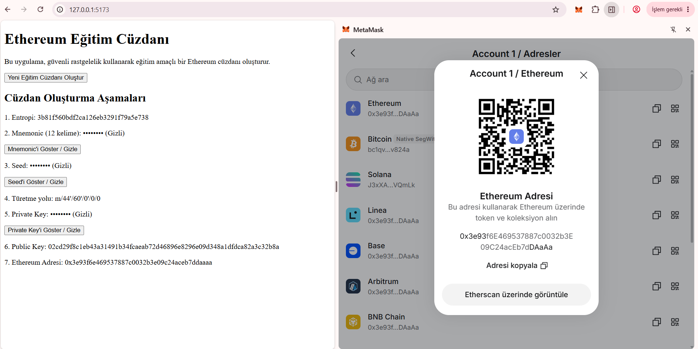

 Quantum Başlangıç

Projenin Amacı

Bu projenin amacı blokzincir teknolojisinin temellerini öğrenmek ve Ethereum üzerinde uygulamalar geliştirmektir.

Öğrenilecek Konular

* Blokzincir teknolojisi
* Git ve GitHub
* Ethereum ve MetaMask
* Kriptografik cüzdanlar
* Solidity ve akıllı sözleşmeler
* Sepolia test ağı

Kullanılan Araçlar

* Visual Studio Code
* Git
* GitHub
* MetaMask
* Remix IDE

ARAŞTIRMA NOTLARI:
# A) Blokzincir Temelleri

## İP 01: Blokzincir ve Ortak Kayıt

**1. Blokzincir, işlem, blok ve dağıtık defter nedir? Birbirleriyle nasıl ilişkilidir?**

Blokzincir, verilerin birbirine kriptografik olarak bağlanan bloklar içerisinde saklandığı bir kayıt sistemidir.
İşlem (transaction), ağ üzerinde gerçekleştirilen varlık transferi veya veri güncellemesi gibi eylemleri ifade eder.
Blok, işlemlerin bir araya getirildiği veri yapısıdır.
Dağıtık defter ise kayıtların ağdaki birden fazla katılımcı tarafından tutulmasıdır.
İşlemler blokları, birbirine bağlanan bloklar ise blokzinciri oluşturur.

**2. Merkezi veritabanıyla blokzincir arasında kayıt kontrolü ve güven açısından ne fark vardır?**

Merkezi veritabanında kayıtların kontrolü genellikle tek bir kişi veya kuruma aittir. Kullanıcıların bu otoriteye güvenmesi gerekir. Merkeziyetsiz bir blokzincirde ise kayıtlar ağdaki katılımcılar tarafından ortak kurallara göre doğrulanır. Böylece tek bir otoriteye duyulan güven ihtiyacı azalır ve geçmiş kayıtların değiştirilmesi zorlaşır.

**3. Geçmiş işlemin kaydı ile sözleşmede tutulan güncel değerin değişmesi nasıl ayrılır?**

Blokzincirde geçmiş işlemler kayıt altında kalırken akıllı sözleşmede tutulan güncel değer yeni işlemlerle değiştirilebilir. Örneğin bir etkinliğin katılımcı sayısı 5’ten 6’ya çıktığında sözleşmedeki güncel değer 6 olur ancak önceki işlemlerin kayıtları silinmez.

**4. Bir etkinlik kayıt sisteminde blokzincir kullanmanın yararı ve ek maliyeti ne olabilir?**

Blokzincir kullanılması kayıtların şeffaf, doğrulanabilir ve değiştirilmesi zor olmasını sağlar. Katılımcılar kayıt durumlarını bağımsız olarak kontrol edebilir. Ancak işlem ücretleri, işlem onay süreleri, veri mahremiyeti ve teknik geliştirme zorluğu gibi ek maliyetler ortaya çıkabilir.

### Benim yorumum: Hangi durumda normal veritabanını tercih ederdiniz?

Sistemin tek bir güvenilir kurum tarafından yönetildiği, yüksek işlem hızının önemli olduğu ve verilerin gerektiğinde değiştirilmesi veya silinmesi gereken durumlarda normal veritabanını tercih ederdim. Çünkü böyle durumlarda blokzincir kullanmak gereksiz maliyet ve karmaşıklık oluşturabilir.

## İP 02: Node ve Konsensüs

**1. Node ve validator nedir? Her node blok üretir mi?**

Node (düğüm), blokzincir ağına katılan, ağdaki verileri paylaşan ve türüne göre saklayan veya doğrulayan bilgisayardır.
Validator (doğrulayıcı) ise özellikle PoS sistemlerinde konsensüs sürecine katılan, blokları doğrulayan ve seçildiğinde blok öneren katılımcıdır.
Hayir her node blok üretmez.

**2. Konsensüs neyi sağlar? PoW ve PoS’un temel yaklaşımları nasıl farklılaşır?**

Konsensüs, ağdaki katılımcıların geçerli işlemler ve blokzincirin durumu üzerinde uzlaşmasını sağlar.
PoW (Proof of Work): Blok üretmek için hesaplama gücüne dayalı bir rekabet gerçekleştirilir.
PoS (Proof of Stake): Doğrulayıcılar, teminat olarak kilitledikleri varlıklar ve protokolün seçim kuralları doğrultusunda blok üretme ve doğrulama süreçlerine katılır.
PoS, PoW’a kıyasla genellikle daha az enerji tüketir.

**3. Public/private ve permissionless/permissioned ağ kavramları hangi özellikleri anlatır?**

Public ve private kavramları ağın erişilebilirliğiyle,
Permissionless ve permissioned kavramları ise ağa katılım izinleriyle ilgilidir.
Public: ağdaki kayıtlar genel erişime acıktır.
Private: ağa erişim belirli kişi veya kurumlarla sınırlandırılır.
Permissionless: katılım için merkezi bir otoriteden özel izin alınması gerekmez.
Permissioned: belirli ağ rollerine katılmak için yetkilendirme gerekir.

**4. İşlemin bloğa alınması, başarılı çalışması ve kesinleşmesi neden farklıdır?**

İşlemin bloğa alınması, işlemin blokzincire dahil edildiğini gösterir.
Başarılı çalışması, işlemin amaçlanan değişikliği hata vermeden gerçekleştirmesidir.
Kesinleşmesi ise işlemin bulunduğu bloğun ağın konsensüs kuralları doğrultusunda geri alınmasının son derece zor veya protokol kapsamında mümkün olmayan hâle gelmesidir. Başarısız bir işlem de blok içerisinde kayıtlı olabilir.

### Benim yorumum: Tek bir node kapanınca bütün ağın durup durmayacağı neye bağlıdır?

Bu durum ağın merkeziyetsizlik derecesine, aktif node sayısına ve konsensüs mekanizmasına bağlıdır. Yeterli sayıda bağımsız katılımcının bulunduğu bir ağda tek bir node un kapanması genellikle ağı durdurmaz. Ancak ağ az sayıda kritik doğrulayıcıya bağımlıysa işlemler aksayabilir veya ağ durabilir.

# A) Cüzdan, Varlık ve Sözleşme Kavramları

## İP 03: Kriptografi ve Cüzdan

**1. Hash, şifreleme ve dijital imza hangi farklı amaçlarla kullanılır?**

Hash: veri bütünlüğü, şifreleme gizlilik, dijital imza ise doğrulama ve yetkilendirme amacıyla kullanılır.
Şifreleme: veriyi yetkisiz kişilerin okuyamayacağı hâle getirir. Uygun anahtarla veri çözülebilir.
Dijital İmza: işlemin ilgili anahtar sahibi tarafından yetkilendirildiğini ve değiştirilmediğini doğrulamayı sağlar.

**2. Private key, public key, adres, mnemonic ve seed arasındaki ilişki nedir?**

Private key (özel anahtar), işlemlerin imzalanmasını sağlayan gizli anahtardır.
Public key (açık anahtar), özel anahtardan türetilir ve dijital imzaların doğrulanmasında kullanılır.
Adres ise Ethereum’da açık anahtardan elde edilen hesap tanımlayıcısıdır.
Mnemonic, cüzdanın kurtarılmasında kullanılan kelime dizisidir.
Seed ise mnemonic ve varsa ek parola kullanılarak elde edilen, anahtarların türetilmesini sağlayan veridir.

**3. Entropi ve checksum ne işe yarar? BIP39, BIP32 ve BIP44 hangi aşamalarla ilgilidir?**

Entropi, anahtar oluşturma sürecinde kullanılan rastgeleliği ifade eder.
Checksum (kontrol toplamı) ise verideki belirli hataların tespit edilmesini sağlar.

BIP39: Mnemonic kelimelerinin ve seed’in oluşturulmasını standartlaştırır.
BIP32: Bir başlangıç verisinden hiyerarşik olarak birden fazla anahtar türetilmesini sağlar.
BIP44: Farklı kripto varlıklar ve hesaplar için standart bir anahtar türetme yolu belirler.

**4. Cüzdan uygulaması ile hesap aynı şey midir? Adresi paylaşmakla anahtarı paylaşmak neden farklıdır? Adres paylaşımının mahremiyet etkisi var mıdır?**

Cüzdan uygulaması, kullanıcıların hesaplarını yönetmesini ve blokzincirle etkileşim kurmasını sağlayan yazılımdır.
Hesap ise blokzincir üzerindeki bir kimliği temsil eder. Bir cüzdan uygulaması birden fazla hesabı yönetebilir.
Adres paylaşımı tek başına başkalarına hesabı kontrol etme yetkisi vermez. Ancak özel anahtarın paylaşılması hesabın kontrolünün başkasına geçmesine neden olabilir. Ayrıca açık blokzincirlerde adres üzerinden işlem geçmişi ve bakiye incelenebildiğinden adres paylaşımı mahremiyeti etkileyebilir.

### Benim yorumum: Cüzdan uygulamasının silinmesiyle kurtarma bilgisinin kaybolmasını karşılaştırın.

Cüzdan uygulamasının silinmesi blokzincirdeki hesabın veya varlıkların silinmesi anlamına gelmez. Kurtarma bilgisi mevcutsa hesap yeniden erişilebilir hâle getirilebilir. Ancak kurtarma bilgisi ve özel anahtar kaybolmuşsa, başka bir erişim yöntemi de bulunmuyorsa hesaba erişim kalıcı olarak kaybedilebilir. Bu nedenle kurtarma bilgisinin korunması uygulamanın korunmasından daha önemlidir.

## İP 04: Bitcoin, Ethereum ve Token

**1. Bitcoin ve Ethereum’un temel amaçları ve programlanabilirliği nasıl farklılaşır?**

Bitcoin, merkezi bir otoriteye ihtiyaç duymadan dijital değer transferi gerçekleştirmek amacıyla geliştirilmiştir.
Ethereum ise değer transferinin yanı sıra akıllı sözleşmelerin ve merkeziyetsiz uygulamaların çalıştırılmasını sağlayan bir platformdur. Bitcoin sınırlı bir betik diline sahipken Ethereum daha geniş programlama olanakları sunar.

**2. Native varlık ve token nedir? ETH ve USDC üzerinden açıklayın.**

Native varlık, bir blokzincirin kendi protokolüne ait temel varlığıdır. Token ise mevcut bir blokzincir üzerinde oluşturulan dijital varlıktır.
ETH, Ethereum ağının native varlığıdır ve işlem ücretlerinin ödenmesinde kullanılır. Ethereum üzerindeki USDC ise akıllı sözleşme aracılığıyla oluşturulan, değeri ABD dolarına bağlı tutulması hedeflenen bir tokendır.

**3. Stablecoin, NFT ve ERC-20 kavramları neyi ifade eder?**

Stablecoin: Değeri belirli bir para birimine veya varlığa bağlı tutulması hedeflenen dijital varlıktır. USDC gibi.
NFT: Benzersiz bir dijital varlığı veya hakkı temsil eden, birbirinin yerine geçemeyen tokendır.
ERC-20: Ethereum üzerinde birbirinin yerine geçebilen tokenların oluşturulması ve yönetilmesi için kullanılan teknik standarttır.

**4. Mainnet ve testnet neden ayrılır? Test ETH ve test USDC gerçek varlıklarla aynı ekonomik değeri taşır mı?**

Mainnet, gerçek işlemlerin gerçekleştirildiği ve ekonomik değere sahip varlıkların kullanıldığı ana ağdır.
Testnet ise geliştiricilerin uygulamalarını ve akıllı sözleşmelerini gerçek varlıkları riske atmadan test edebildiği ağdır.
Test ETH ve test USDC, test amacıyla kullanılır ve gerçek ETH ile USDC’nin ekonomik değerini taşımaz.

### Benim yorumum: Etkinliğe giriş hakkını temsil etmek için mutlaka token gerekir mi?

Hayir etkinliğe giriş hakkını temsil etmek için mutlaka token kullanılması gerekmez. Akıllı sözleşme içerisinde kullanıcının adresi, kayıt durumu ve giriş hakkı saklanarak da bu sistem oluşturulabilir. Ancak giriş hakkının devredilmesi veya benzersiz bir dijital bilet olarak temsil edilmesi isteniyorsa NFT kullanılması tercih edilebilir. Token kullanma kararı sistemin ihtiyaçlarına göre verilmelidir.

## İP 05: Akıllı Sözleşme ve ABI

**1. Akıllı sözleşme, EVM ve state nedir?**

Akıllı sözleşme (Smart Contract), blokzincir üzerinde çalışan ve belirlenen kurallara göre işlemleri gerçekleştiren programdır.
EVM (Ethereum Virtual Machine), Ethereum ağındaki akıllı sözleşmelerin çalıştırılmasını sağlayan sanal makinedir.
State ise hesap bakiyeleri, katılımcı sayısı ve kayıt durumları gibi blokzincirde tutulan güncel bilgileri ifade eder.

**2. Kaynak kod, derleme ve bytecode nasıl ilişkilidir? Deploy ne yapar?**

Kaynak kod, geliştiricinin Solidity gibi bir programlama diliyle yazdığı koddur.Derleme (compile) bu kodun EVM tarafından çalıştırılabilecek bytecode’a dönüştürülmesidir.
Deploy ise derlenen sözleşmenin blokzincire yayınlanmasını sağlar. Başarılı bir deploy işleminden sonra sözleşme kendisine ait bir adrese sahip olur.

**3. ABI ne işe yarar? Ne zaman elde edilir? Bir sözleşmenin adresi dışında hangi arayüz bilgilerine ihtiyaç duyabilirsiniz?**

ABI (Application Binary Interface), uygulamaların akıllı sözleşmeyle nasıl iletişim kuracağını belirleyen arayüzdür. Sözleşmenin derlenmesi sırasında elde edilir. Sözleşmenin adresi dışında fonksiyon isimlerine, parametrelerine, dönüş değerlerine, veri türlerine ve event bilgilerine ihtiyaç duyulabilir.

**4. Veri okumak ile state değiştiren işlem göndermek nasıl ayrılır?**

Veri okuma işlemi, sözleşmedeki mevcut bilgileri değiştirmeden görüntülemeyi sağlar. Zincir dışından yapılan okuma çağrıları genellikle işlem ücreti ve imza gerektirmez.
State değiştiren işlemler ise blokzincirdeki güncel verileri değiştirir. Bu nedenle imzalanmaları, ağa gönderilmeleri ve işlem ücretinin ödenmesi gerekir.

**5. Kaynak kodu verify etmek neyi doğrular? Güvenlik denetimiyle aynı şey midir?**

Verify işlemi, paylaşılan kaynak kodun belirtilen derleme ayarlarıyla blokzincire yayınlanan bytecode ile eşleştiğini doğrular.
Güvenlik denetimi (audit) ise sözleşmedeki güvenlik açıklarını ve mantıksal hataları tespit etmeyi amaçlar. Bir sözleşmenin verify edilmiş olması güvenli olduğu anlamına gelmez.

### Benim yorumum: Aynı kod iki farklı adrese yayınlanınca kayıtları neden ayrı olabilir?

Aynı kaynak kod kullanılsa bile her deploy işlemi bağımsız bir sözleşme oluşturur. Her sözleşmenin kendine ait adresi ve veri saklama alanı bulunur. Bu nedenle bir sözleşmede yapılan kayıt veya değişiklik diğer sözleşmeyi etkilemez.

# A) Ağ Erişimi, İşlemler ve Ekosistem

## İP 06: RPC, Explorer ve Event

**1. RPC ve RPC endpoint nedir? Node ve RPC hizmet sağlayıcısı ile ilişkileri nasıldır?**

RPC (Remote Procedure Call), bir uygulamanın uzaktaki bir node ile iletişim kurmasını sağlayan yöntemdir.
RPC endpoint ise bu iletişimin gerçekleştirildiği bağlantı adresidir. RPC hizmet sağlayıcıları, kullanıcıların kendi node’larını çalıştırmalarına gerek kalmadan blokzincirdeki verilere erişmelerini ve işlem göndermelerini sağlar.

**2. Block explorer nedir? Explorer’ın veya bir RPC adresinin kapanması ağın durduğunu gösterir mi?**

Block explorer, blokzincirdeki işlemlerin, blokların, hesapların ve akıllı sözleşmelerin incelenmesini sağlayan araçtır. Etherscan buna örnektir.
Explorer’ın veya bir RPC adresinin kapanması blokzincirin durduğu anlamına gelmez. Ağdaki diğer node’lar çalışmaya devam ediyorsa blokzincir faaliyetlerini sürdürebilir.

**3. Event/log ile sözleşmenin güncel state’i nasıl ayrılır? Indexer ne işe yarar?**

Event, akıllı sözleşmede gerçekleşen önemli olayların bildirilmesini sağlayan mekanizmadır.
Log ise bu olayın işlem sonucunda oluşturulan kaydıdır.
State, sözleşmenin güncel durumunu gösterirken event ve log geçmişte gerçekleşen olayların takip edilmesini sağlar.
Indexer ise blokzincirdeki verileri toplar, düzenler ve daha hızlı sorgulanabilir hâle getirir.

### Benim yorumum: Explorer olmadan bir kaydı kontrol etmek için hangi yolu araştırırdınız?

Sözleşmenin adresini ve ABI bilgisini kullanarak ilgili fonksiyonları çağırabilir, işlem kayıtlarını ve sözleşmenin güncel durumunu explorer kullanmadan kontrol edebilirdim.

## İP 07: Bir İşlemin Yolculuğu

**1. Cüzdan bağlamak, mesaj imzalamak ve işlem göndermek hangi farklı işlemlerdir?**

Cüzdan bağlamak: Bir uygulamanın kullanıcının cüzdan adresine erişmesini ve cüzdanla iletişim kurmasını sağlar. Tek başına blokzincirde değişiklik oluşturmaz.
Mesaj imzalamak: Kullanıcının ilgili hesabın kontrolüne sahip olduğunu veya belirli bir mesajı onayladığını kanıtlamasını sağlar. Tek başına zincire işlem göndermez ancak bazı imzalar uygulamalara belirli yetkiler verebilir.
İşlem göndermek: Varlık transferi veya akıllı sözleşmenin durumunu değiştirme gibi işlemlerin blokzincir ağına iletilmesidir. İşlem ücreti gerektirir.

**2. Gas limit, gas used, işlem ücreti, nonce ve chain ID ne işe yarar?**

Gas limit: Bir işlemin kullanmasına izin verilen maksimum gas miktarıdır.
Gas used: İşlem gerçekleştirilirken kullanılan gerçek gas miktarıdır.
İşlem ücreti: İşlemin gerçekleştirilmesi için ödenen bedeldir.
Nonce: Bir hesabın işlemlerinin sırasını belirleyen ve aynı işlemin tekrar yürütülmesini önlemeye yardımcı olan sayıdır.
Chain ID: İşlemin hangi blokzincir ağına ait olduğunu belirleyen kimlik numarasıdır. İşlemlerin farklı ağlarda izinsiz tekrar kullanılmasını önlemeye yardımcı olur.

**3. Txid/transaction hash, sözleşme adresi ve block hash neyi tanımlar?**

Transaction hash (Txid): Bir işlemi tanımlayan benzersiz kriptografik özettir.
Sözleşme adresi: Blokzincire yayınlanmış bir akıllı sözleşmenin konumunu ve kimliğini belirleyen adrestir.
Block hash: Blok başlığından elde edilen ve ilgili bloğu tanımlayan kriptografik özettir.

**4. Pending, receipt ve status nedir? İşlem hash’i neden tek başına başarı kanıtı değildir?**

Pending, işlemin henüz bir bloğa alınmadığı bekleme durumudur.
Receipt, işlem bloğa alındıktan sonra oluşan ve işlemin sonucuyla ilgili bilgileri içeren işlem makbuzudur.
Status ise işlemin başarılı veya başarısız olduğunu gösterir.
İşlem hash’inin oluşması işlemin başarıyla tamamlandığı anlamına gelmez. İşlem hâlâ bekliyor veya başarısız olmuş olabilir. Bu nedenle receipt ve status bilgilerinin kontrol edilmesi gerekir.

**5. İmzalama, gönderme, bekleme, bloğa alınma ve sonuç kontrolünü gösteren akış şeması**

quantum-baslangic dosyasına oluşturduğum akis semasını ekledim.

### Benim yorumum: “İşlem başarısız” ile “sonucunu öğrenemedim” neden farklıdır?

İşlemin başarısız olması, işlemin çalıştırıldığı ancak amaçlanan değişikliğin gerçekleşmediği anlamına gelir. Sonucunu öğrenememek ise bağlantı sorunu, RPC hatası veya işlemin hâlâ beklemede olması gibi nedenlerden kaynaklanabilir. Sonucunu öğrenemediğim bir işlemin başarısız olduğunu varsaymak yerine işlem durumunu tekrar kontrol edilebilir.

## İP 08: Ekosistemi Tanı

**1. Web3, L1/L2, DeFi, DAO, oracle, bridge ve zero-knowledge proof (ZK) kavramlarını açıklayın.**

Web3: Blokzincir ve merkeziyetsiz teknolojiler kullanılarak kullanıcıların dijital varlıkları ve kimlikleri üzerinde daha fazla kontrol sahibi olmasını hedefleyen internet yaklaşımıdır.
L1 (Layer 1): Kendi konsensüs mekanizmasına ve işlem doğrulama sistemine sahip temel blokzincir ağıdır. Bitcoin ve Ethereum buna örnektir.
L2 (Layer 2): Ana blokzincirin üzerinde çalışan, işlem kapasitesini artırmayı ve işlem maliyetlerini azaltmayı amaçlayan ölçeklendirme çözümleridir. Arbitrum ve Optimism buna örnektir.
DeFi (Decentralized Finance): Borç verme, borç alma ve varlık takası gibi finansal işlemlerin akıllı sözleşmeler aracılığıyla gerçekleştirilmesini sağlayan merkeziyetsiz finans sistemidir.
DAO (Decentralized Autonomous Organization): Kararların topluluk katılımıyla ve belirlenen yönetişim kurallarıyla alındığı merkeziyetsiz organizasyon yapısıdır.
Oracle: Blokzincir dışındaki fiyat, hava durumu ve benzeri bilgilerin akıllı sözleşmelere aktarılmasını sağlayan sistemdir.
Bridge: Farklı blokzincir ağları arasında varlıkların veya bilgilerin aktarılmasını sağlayan köprü sistemidir.
Zero-Knowledge Proof (ZK): Bir bilginin doğruluğunu, bilginin kendisini açıklamadan matematiksel olarak kanıtlamayı sağlayan kriptografik yöntemdir.

**2. Dijital kimlik, RWA ve DePIN için birer kullanım örneği bulun.**

Dijital kimlik (Digital Identity): Bir öğrencinin üniversiteye kayıtlı olduğunu doğrulanabilir bir dijital belge aracılığıyla kanıtlaması örnek olarak verilebilir.
RWA (Real World Assets): Gayrimenkul, altın veya tahvil gibi gerçek dünya varlıklarının ya da bunlara ilişkin hakların blokzincir üzerinde dijital olarak temsil edilmesidir. Bir gayrimenkule ilişkin mülkiyet haklarının tokenlarla temsil edilmesi buna örnektir.
DePIN (Decentralized Physical Infrastructure Networks): Fiziksel altyapının merkeziyetsiz katılımcılar tarafından oluşturulmasını ve işletilmesini amaçlayan ağlardır. Helium projesinde katılımcıların kablosuz iletişim altyapısına katkı sağlaması buna örnektir.

**3. ZK ile neyin kanıtlandığını ve hangi bilginin saklanabildiğini basit bir örnekle anlatın. ZK kullanılması bütün işlemlerin gizli olduğu anlamına gelir mi?**

Örneğin bir kişi, doğum tarihini açıklamadan 18 yaşından büyük olduğunu ZK yöntemiyle kanıtlayabilir. Bu durumda yaş şartının sağlandığı doğrulanırken kişinin doğum tarihi gizli kalır.
Ancak bir sistemde ZK kullanılması bütün işlemlerin gizli olduğu anlamına gelmez. ZK, işlem doğruluğunu kanıtlamak veya ölçeklenebilirliği artırmak amacıyla da kullanılabilir. Hangi bilgilerin gizli kalacağı sistemin tasarımına bağlıdır.

### Benim yorumum: Hangi alanı daha sonra öğrenmek istersiniz ve neden?

Zero-Knowledge Proof (ZK) teknolojisini daha detaylı öğrenmek isterdim. Çünkü kişisel bilgilerin paylaşılmasına gerek kalmadan doğrulama yapılabilmesi, veri güvenliği ve mahremiyet açısından önemli avantajlar sağlamaktadır. Özellikle dijital kimlik, kimlik doğrulama ve güvenli veri paylaşımı gibi alanlarda bu teknolojinin nasıl kullanılabileceğini araştırmak isterdim.

## İP 09: Gerçek Bir Blokzincir Projesini İnceleme

ENS – Ethereum Name Service
İncelediğim proje, Ethereum blokzinciri üzerinde çalışan açık kaynaklı ve merkeziyetsiz bir isimlendirme sistemi olan Ethereum Name Service (ENS) projesidir. Uzun ve karmaşık blokzincir adreslerinin insanlar tarafından daha kolay okunabilen isimlerle eşleştirilmesini sağlar.
- Resmî sitesi: ens.domains
- Dokümantasyonu: docs.ens.domains
- Kaynak kodları: GitHub – ENS Contracts

Hangi problemi çözüyor?
Ethereum adresleri uzun ve karmaşık karakterlerden oluşur. Bu durum adreslerin hatırlanmasını zorlaştırır ve yanlış adres girilmesi riskini artırır. ENS, bu adresleri okunabilir isimlerle eşleştirerek kullanım kolaylığı sağlar.
Bu sistem internet sitelerinde kullanılan DNS sistemine benzer. DNS, alan adlarını IP adresleriyle ilişkilendirirken ENS, okunabilir isimleri blokzincir adresleri ve başka veri kayıtlarıyla ilişkilendirir.

Kimler için çözüyor?
Blokzincir kullanıcıları
Web3 uygulaması geliştiren yazılımcılar
Merkeziyetsiz uygulama
(DApp) kullanıcıları
Dijital kimlik oluşturmak isteyen kişiler
Blokzincir tabanlı hizmet geliştiren kuruluşlar

Zincir içi ve zincir dışı işlemler

Zincir içi (On-chain)

-İsimlerin kaydedilmesi
-İsim sahipliğinin saklanması
-Sahipliğin devredilmesi
-Zincir üzerindeki adres kayıtlarının güncellenmesi
-Akıllı sözleşmelerle yetki kontrolü
-Kayıt ve yenileme işlemleri

Zincir dışı (Off-chain)

-Web sitesinin kullanıcı arayüzü
-İsim arama arayüz
-Önbellekleme hizmetleri
-Verilerin kullanıcıya gösterilmesi
-Harici sunucularda tutulan bazı kayıtlar
-Bazı veri indeksleme hizmetleri

Neden blokzincir kullanıyor ve normal bir veritabanıyla yapılsaydı ne değişirdi?
ENS, isimlerin sahipliğinin merkezi bir şirketin kontrolüne tamamen bağımlı olmaması için blokzincir kullanmaktadır. İsim sahipliği ve kayıt kuralları akıllı sözleşmeler aracılığıyla yönetilir.
Blokzincir sayesinde yetkili kullanıcılar kayıtlarını yönetebilir ve diğer kullanıcılar zincir üzerindeki kayıtları bağımsız olarak doğrulayabilir.
Normal bir merkezi veritabanı kullanılsaydı isimlerin saklanması ve adreslerle eşleştirilmesi yine mümkün olurdu. Ancak sistemin kontrolü büyük ölçüde veritabanını yöneten kuruluşa ait olurdu.
Değerlendirme: ENS için blokzincir kullanımının temel nedeni hız veya düşük maliyet değil; sahiplik, bağımsız doğrulanabilirlik ve merkezi otoriteye olan bağımlılığın azaltılmasıdır.

Kullanıcının yöneticiye, işletmeciye veya veri sağlayıcısına hangi konularda güvendiğini belirtin.
ENS merkeziyetsiz bir sistem olmasına rağmen kullanıcıların belirli konularda
bazı kişi ve kuruluşlara güvenmesi gerekmektedir. Kullanıcılar, ENS DAO'nun sistemin yönetimi, kayıt ücretleri ve protokol değişiklikleri konusunda doğru kararlar alacağına; geliştiricilerin ise akıllı sözleşmeleri güvenli ve hatasız bir şekilde oluşturacağına güvenir.
Bunun yanı sıra kullanıcılar, web uygulamasının işletmecisine bilgilerin doğru gösterilmesi, veri sağlayıcılarına ise blokzincir üzerindeki verilere doğru ve kesintisiz erişim sağlanması konusunda güvenir. Zincir dışında tutulan verilerin kullanılması durumunda bu verilerin erişilebilirliği ve kullanılan doğrulama mekanizmalarının güvenilirliği de önemlidir.
Örneğin, bir ENS isminin sahibi ilgili adres kaydını değiştirebilir. Blokzincir bu değişikliğin yetkili

### Benim yorumum Projenin güçlü tarafı:

Bence ENS projesinin en güçlü tarafı, blokzincir teknolojisinin günlük kullanımını kolaylaştırırken kullanıcıların dijital isimleri üzerindeki kontrolünü artırmasıdır. Karmaşık adresler yerine okunabilir isimlerin kullanılması, sistemin daha anlaşılır olmasını sağlamaktadır. Ayrıca kayıtların bağımsız olarak doğrulanabilmesi önemli bir avantajdır.
Projenin sınırlaması:
Bence projenin en önemli sınırlamalarından biri, zincir üzerinde gerçekleştirilen kayıt ve güncelleme işlemlerinin belirli maliyetler oluşturabilmesidir. Merkezi bir veritabanında daha hızlı ve düşük maliyetli gerçekleştirilebilecek işlemler blokzincirde daha maliyetli olabilir. Bu nedenle her isimlendirme sisteminde blokzincir kullanılmasının gerekli olmadığını düşünüyorum.

## İP 10: Blokzincir Yarışması Şartnamesini İnceleme

Yarışmanın çözülmesini istediği genel problemleri ve takımın geçmişte hedeflediği kapsamları özetleyin.
Yarışma; blokzincir ağlarının ölçeklenebilirliği, işlem maliyetleri, veri gizliliği, dijital cüzdanlar, kriptografi, güvenlik ve yasal düzenlemelere uyumluluk gibi problemlere çözüm üretilmesini hedeflemektedir. Ayrıca farklı sektörlerde blokzincir tabanlı uygulamaların geliştirilmesini desteklemektedir.
- DLT: Verilerin dağıtık olarak saklanmasını sağlayan defter teknolojisidir.
- Ölçeklenebilirlik: Sistemin artan işlem ve kullanıcı sayısını karşılayabilmesidir.
- ZKP: Bir bilgiyi açıklamadan doğruluğunu kanıtlama yöntemidir.
- MPC: Tarafların gizli verilerini paylaşmadan ortak hesaplama yapabilmesidir.
- Rollup: İşlemleri gruplayarak ana zincirin işlem yükünü azaltan yöntemdir.
- Tokenizasyon: Varlıkların blokzincir üzerinde dijital olarak temsil edilmesidir.
- Regülasyon: Yasal düzenlemeler ve kurallardır.

### Benim yorumum

Bence bu programda öğrendiğim akıllı sözleşmeler, kriptografi, dijital cüzdanlar, konsensüs mekanizmaları ve güvenlik konuları yarışmada oldukça işe yarayacaktır.
Ayrıca RPC, ABI ve event gibi kavramların uygulama geliştirme sürecinde işe yarayacağını düşünüyorum. Bunların yanında, blokzincirin hangi problemlerde kullanılmasının gerçekten gerekli olduğunu anlayabilmenin başarılı bir proje geliştirmek açısından önemli olduğunu düşünüyorum.

## IP 11

Git: Dosyalarımızda yaptığımız değişiklikleri takip etmemizi sağlayan bir sürüm kontrol sistemidir. Önceki sürümlere dönmemize yardımcı olur.

GitHub: Git ile oluşturduğumuz projeleri internet üzerinde saklayabildiğimiz ve paylaşabildiğimiz bir platformdur.

README: Projenin amacını, içeriğini ve kullanımını açıklayan dosyadır. Genellikle README.md adıyla oluşturulur.

Commit: Projemizde yaptığımız değişiklikleri Git geçmişine kaydetme işlemidir.

Push: Bilgisayarımızdaki Git kayıtlarını GitHub gibi uzak bir depoya gönderme işlemidir.

Remix IDE: Solidity dilinde akıllı sözleşmeler yazmak, derlemek, test etmek ve blokzincire dağıtmak için kullanılan tarayıcı tabanlı bir geliştirme ortamıdır.

Solidity: Ethereum gibi uyumlu blokzincirlerde çalışan akıllı sözleşmeler geliştirmek için kullanılan bir programlama dilidir.

## IP 11 – Benim Yorumum:

Git, GitHub, Visual Studio Code, MetaMask ve Remix IDE araçlarının hepsini ilk kez kullandım. Başlangıçta bu araçların ne işe yaradığını bilmiyordum. Yapay zekadan yardım alarak kurulumları adım adım gerçekleştirdim. 

Visual Studio Code üzerinde proje klasörümü ve README dosyamı oluşturdum. Git komutlarını kullanarak değişikliklerimi kaydettim ve GitHub'a gönderdim. MetaMask cüzdanımı kurup Sepolia test ağını açtım. Ayrıca Remix IDE'yi inceleyerek Solidity dosyalarının nerede oluşturulduğunu öğrendim.

## IP 12 - Ethereum Eğitim Cüzdanı Oluşturucu

Bu projede JavaScript kullanarak eğitim amaçlı bir Ethereum cüzdanı oluşturma uygulaması geliştirdim.

Cüzdan Oluşturma Aşamaları

1. Entropi: crypto.getRandomValues() ile kriptografik olarak güvenli 128 bit rastgele veri üretilir.
2. Mnemonic: entropyToMnemonic() fonksiyonu ve @scure/bip39 kütüphanesi kullanılarak entropi, BIP39 standardına uygun 12 İngilizce kelimeye dönüştürülür.
3. Seed: mnemonicToSeedSync() fonksiyonu ile mnemonic kelimelerinden 512 bit seed üretilir. Ek passphrase kullanılmaz.
4. Private Key: HDKey.fromMasterSeed() ve derive() fonksiyonlarıyla seed’den m/44'/60'/0'/0/0 türetme yolu kullanılarak Ethereum özel anahtarı elde edilir.
5. Public Key: Türetilen anahtardan açık anahtar elde edilir. Ethereum adresi hesaplanırken açık anahtarın sıkıştırılmamış biçimi kullanılır.
6. Ethereum Adresi: Açık anahtarın ilk baytı çıkarılır, kalan veriye keccak_256() uygulanır ve hash sonucunun son 20 baytı alınarak Ethereum adresi oluşturulur.

Kullanılan Kütüphaneler

* @scure/bip39: Mnemonic ve seed oluşturma.
* @scure/bip32: Hiyerarşik anahtar türetme.
* @noble/secp256k1: Açık anahtar dönüşümü.
* @noble/hashes: Keccak-256 hesaplama.

Güvenlik

Uygulama eğitim amaçlıdır. Mnemonic, seed ve özel anahtar varsayılan olarak gizlenir ve kullanıcı isterse ekranda görüntülenebilir. Gizli bilgilerin gerçek kullanımda paylaşılmaması gerekir.
   
## IP 12 – Benim Yorumum: Mnemonic ile Private Key Arasındaki Fark

Mnemonic, cüzdanı yedeklemek ve gerektiğinde yeniden oluşturmak için kullanılan, genellikle 12 veya 24 kelimeden oluşan bir ifadedir.

Private Key ise belirli bir Ethereum hesabının işlemlerini imzalamak için kullanılan gizli anahtardır.

Mnemonic kelimelerinden bir seed oluşturulabilir ve bu seed kullanılarak farklı hesaplara ait birden fazla Private Key türetilebilir.

Bu nedenle mnemonic ve Private Key aynı şey değildir. Mnemonic genellikle birden fazla hesabı kurtarmamızı sağlarken Private Key belirli bir hesabı kontrol etmemizi sağlar.

Her ikisi de gizli tutulmalıdır.

## İP 13 

## MetaMask ile Ethereum Adresi Karşılaştırması

Geliştirdiğim eğitim cüzdanı uygulamasındaki Ethereum adresi ile MetaMask’teki Ethereum adresini karşılaştırdım. Karşılaştırma sonucunda iki adresin eşleştiğini gözlemledim.

Karşılaştırma sonucunu ekran görüntüsüyle belgeledim. Güvenlik nedeniyle ekran görüntüsünde mnemonic, seed, entropi ve private key bilgilerine yer vermedim.

## Checksum Deneyi

BIP39 doğrulama işlemi için @scure/bip39 kütüphanesinin validateMnemonic fonksiyonunu kullandım.

* Orijinal örnek mnemonic doğrulandığında true sonucu alındı.
* İlk kelime, BIP39 kelime listesinde bulunan başka bir kelimeyle değiştirildiğinde false sonucu alındı.

Bu deneyde checksum mekanizmasının kelime değişikliğinden kaynaklanan hatayı tespit edebildiğini gözlemledim. Ancak tek kelime değişikliği her zaman geçersiz bir mnemonic oluşturmaz. Bu nedenle checksum’ın hata yakalama kapasitesi sınırlıdır.

## IP 13 - Benim Yorumum: Geçerli ve Güvenli Mnemonic Arasındaki Fark

Geçerli bir mnemonic ile güvenli biçimde üretilmiş bir mnemonic aynı şey değildir. Bir mnemonic’in geçerli olması, BIP39 kelime listesine ve checksum kurallarına uygun olduğunu gösterir. Ancak bu durum, mnemonic’in güvenli ve tahmin edilemez olduğunu kanıtlamaz.

Yaptığım deneyde sabit test verisinden oluşturulan mnemonic doğrulamadan geçmiştir. Fakat tahmin edilebilir olduğu için güvenli değildir.

Bu nedenle güvenli bir mnemonic oluşturmak için kriptografik olarak güvenli rastgelelik kullanılmalıdır.

## İP 14: Test ETH Kaynağını Kendin Bul

Faucet Araştırması ve Test ETH Edinme

MetaMask üzerinde Sepolia test ağını seçtim. Ethereum’un resmî dokümantasyonundan faucet kaynaklarını araştırdım.

Alchemy, Google Cloud, QuickNode ve Sepolia PoW Faucet seçeneklerini inceledim. Gerçek ETH bakiyesi gerektiren seçenekleri tercih etmedim.

Sepolia PoW Faucet kullanarak herhangi bir satın alma işlemi yapmadan 0.5325 test ETH edindim. Gelen bakiyeyi MetaMask üzerinden kontrol ettim ve işlemin başarılı olduğunu Sepolia Etherscan üzerinden doğruladım.

* Faucet adresi: https://sepolia-faucet.pk910.de/
* Ağ: Ethereum Sepolia
* Alınan miktar: 0.5325 SepETH
* İşlem durumu: Success
* Blok numarası: 12204094

PoW Faucet ile Sepolia’da Blok Üretmenin Farkı

PoW faucet, ücretsiz test ETH dağıtmak için kullanıcının tarayıcısında hesaplama işlemleri gerçekleştirir. Bunun amacı kötüye kullanımı ve botları önlemektir.

Bu hesaplamalar Sepolia ağında blok üretildiği anlamına gelmez. Sepolia, Proof of Stake konsensüs mekanizmasını kullanır. Faucet üzerindeki hesaplamalar yalnızca test ETH dağıtımının bir koşuludur.

Benim Yorumum: Adresi Paylaşmak Neden Harcama Yetkisi Vermez?

Cüzdan adresi, varlık almak ve blokzincir üzerindeki işlemleri görüntülemek için kullanılan herkese açık bir bilgidir. Ancak bir hesaptan varlık göndermek için işlemin ilgili private key ile imzalanması gerekir. Bu nedenle yalnızca cüzdan adresini bilen bir kişi hesaptaki varlıkları harcayamaz.

## İP 15: 

## Test USDC Edin ve İki Transferi Karşılaştır

Amaç: Native varlık ile token arasındaki farkı uygulamalı olarak gözlemlemek.

1. Test USDC edinme

Circle’ın resmî Testnet Faucet sayfasından Ethereum Sepolia ağını seçerek 20 test USDC edindim. Circle’ın resmî dokümantasyonundan Ethereum Sepolia USDC sözleşme adresini buldum.

Faucet: https://faucet.circle.com/

Token sözleşme adresi:

0x1c7D4B196Cb0C7B01d743Fbc6116a902379C7238

Bu sözleşme adresini MetaMask’e özel token olarak ekledim ve 20 USDC bakiyemi görüntüledim.

2. İkinci eğitim hesabını oluşturma

MetaMask üzerinde Account 2 isimli ikinci bir eğitim hesabı oluşturdum. Account 1 hesabımdan Account 2 hesabıma 0.01 Sepolia ETH ve 5 test USDC gönderdim. Sonraki işlemler için ilk hesabımda yeterli miktarda test ETH bıraktım.

Her iki işlemin de başarılı olduğunu Sepolia Etherscan üzerinden doğruladım.

3. İşlemlerin karşılaştırılması

ETH transferinde To alanında doğrudan alıcı hesabın adresi bulunurken USDC transferinde USDC akıllı sözleşmesinin adresi bulunmaktadır.

USDC transferinde Value alanının 0 ETH olmasının nedeni, Value alanının native ETH miktarını göstermesidir. Gönderilen 5 USDC ise token transferi ve event log alanlarında görülmektedir.

ETH işleminde Input Data alanı boş (0x) iken USDC işleminde akıllı sözleşmenin transfer fonksiyonu çağrılmıştır.

Her iki işlemde de Transfer event kaydı bulunmaktadır. ETH işlemindeki kayıt sistem adresinden, USDC işlemindeki kayıt ise USDC sözleşmesinden gelmektedir.

4. Tokenı cüzdanda göstermek ile zincirde almak arasındaki fark

Tokenı MetaMask’e eklemek, blokzincirde yeni bir işlem gerçekleştirmez ve token bakiyesini değiştirmez. Yalnızca mevcut token bakiyesinin cüzdan arayüzünde görüntülenmesini sağlar.

Tokenı zincirde almak ise ilgili token bakiyesinin blokzincir üzerinde değişmesi anlamına gelir. Circle faucet üzerinden aldığım USDC, MetaMask’e özel token olarak eklemeden önce de zincirde hesabıma ait olabilir.

## IP 15 - Benim yorumum:

USDC gönderirken ücretin hangi bakiyeden karşılandığını nasıl gördünüz?

5 USDC gönderdiğim işlemi Etherscan üzerinden incelediğimde Transaction Fee alanında 0.000227668502580243 ETH yazdığını gördüm. Bu sayede USDC transferi yapmama rağmen işlem ücretinin USDC bakiyemden değil, Sepolia ETH bakiyemden karşılandığını öğrendim. Ethereum ağında token transferlerinin işlem ücretleri ağın native varlığı olan ETH ile ödenmektedir.

## IP 16 

## İkinci Kayıt Denemesi
Aynı cüzdan adresiyle register fonksiyonunu ikinci kez çağırmayı denedim. Remix, gas tahmini sırasında “Bu cuzdan zaten kayitli” hatasını verdi.

Hata, işlem blokzincire gönderilmeden önce oluştu. Bu nedenle yeni bir transaction hash oluşmadı ve gas ücreti harcanmadı.

Bu deney sonucunda akıllı sözleşmenin aynı cüzdan adresinden birden fazla kayıt yapılmasını engellediğini doğruladım.

## Kontrol Sitesi ile Doğrulama

Takımın kontrol sitesini açtım ve kaydımın listede göründüğünü doğruladım.

## IP 16 - Benim Yorumum

İsmin kontrol sitesinde görünmesi ile blokzincirde kaydedilmiş olması aynı kontrol değildir. Blokzincir asıl kayıt kaynağıdır. Web sitesi ise bu kayıtları okuyup kullanıcıya gösteren bir arayüzdür. Web sitesinde bağlantı veya veri görüntüleme hatası oluşsa bile blokzincirdeki başarılı kayıt korunur.

## İP 17 – Explorer ile Kaydı Doğrula

Sepolia Etherscan üzerinden takım sözleşmesine yaptığım başarılı kayıt işlemini inceledim.

* From: İşlemi gönderdiğim cüzdanın adresi
* To: Kayıt işlemini gerçekleştirdiğim QuantumKayit akıllı sözleşmesinin adresi
* Gas Price: Kayıt işleminin gerçekleştirilmesi sırasında kullanılan hesaplama birimi miktarı
* Transaction Fee: İşlemin gerçekleştirilmesi için cüzdanımdan ödenen Sepolia ETH miktarı
* Nonce: Cüzdanımdan gönderilen işlemlerin sıra numarasını ifade eder
* Status: İşlemin başarılı olup olmadığını gösterir
* Input Data: Akıllı sözleşmeye gönderdiğim fonksiyon ve parametre bilgilerinin kodlanmış hâli 

## İP 17 -Benim Yorumum

Input Data, register fonksiyonuna hangi bilgiyi gönderdiğimi gösterdi. 
Registered event, kayıt işlemi sırasında hangi olayın gerçekleştiğini gösterdi. 
Mevcut state ise kayitliMi ve tumKayitlar fonksiyonları aracılığıyla kaydımın sözleşmede bulunup bulunmadığını doğrulamamı sağladı.

Bu üç bilgi sırasıyla işlemin girdisini, gerçekleşen olayı ve sözleşmenin güncel durumunu gösterdi.

## İP 18 

## Yeni Sözleşmenin Başlangıç Durumu

- kayitliMi: false
- tumKayitlar: Boş liste

Yeni oluşturduğum sözleşmede henüz hiçbir kayıt
bulunmadığını doğruladım. Takım sözleşmesindeki
kayıtlar yeni sözleşmeye aktarılmadı.

## Deploy ve At Address / Add Contract Farkı

Deploy, blokzincir üzerinde yeni bir akıllı sözleşme
oluşturur. Yeni bir sözleşme adresi oluşur ve gas
ücreti ödenir.

At Address / Add Contract ise daha önce yayınlanmış
bir sözleşmeye adresi üzerinden bağlanmayı sağlar.
Yeni bir sözleşme oluşturmaz ve bağlanmak için
gas ücreti ödenmez.

## İP 18 - Benim Yorumum

Her akıllı sözleşmenin kendine ait bir adresi ve
veri depolama alanı vardır. Kaynak kodları aynı olsa
bile sözleşmelerin tuttukları veriler birbirinden
bağımsızdır. Bu nedenle takım sözleşmesindeki
kayıtlar kendi oluşturduğum sözleşmeye otomatik
olarak aktarılmaz.

## IP 19 - 
## Remix ve Etherscan
Remix ve Etherscan farklı arayüzler olsa da aynı
blokzincir ağı üzerindeki akıllı sözleşmelerle
etkileşim kurabilir. MetaMask aracılığıyla işlemler
imzalanır ve Sepolia ağına gönderilir.

## IP 19 - Benim Yorumum
Aynı cüzdan takım sözleşmesine ikinci kez
kaydolamazken kendi sözleşmeme kaydolabildim.
Çünkü iki sözleşmenin adresleri ve depolama
alanları farklıdır. Her sözleşme kendi kayıtlarını
bağımsız olarak tutar.
Kendi sözleşmemdeki kayıt takımın kontrol sitesinde
görünmez. Çünkü site yalnızca takım sözleşmesini izler.
 

 ## İP 20 

## Test Sonuçları
- Account 1: Katilimci1
- Account 2: Katilimci2
- Her iki kayıt başarıyla oluşturuldu ve okundu.

## Verinin Saklanması
Kayıtlar mapping(address => string) yapısı
kullanılarak sözleşmenin storage alanında tutulur.

## msg.sender'ın Görevi
msg.sender, fonksiyonu çağıran hesabın adresini
belirtir. Böylece kullanıcı yalnızca kendi adresi
adına kayıt yapabilir. 

## IP 20 - Benim Yorumum

Bu ilk sürümde boş takma ad girilmesi, aynı
hesabın tekrar kayıt yaparak önceki kaydını
değiştirmesi ve sınırsız katılımcı kaydı
engellenmemektedir.

## IP 21 – Kapasite ve Kayıt Kuralları

Test Sonuçları
                     
İlk geçerli kayıt	            
Beklenen sonuç: Kabul, toplam 1 	
Gözlemlenen sonuç: Kabul, toplam 1 oldu

Aynı hesaptan tekrar kayıt   	
Beklenen sonuç: Ret, toplam 1	    
Gözlemlenen sonuç: Ret, toplam 1 oldu

Yeni hesaptan boş ad        	
Beklenen sonuç: Ret, toplam 1	    
Gözlemlenen sonuç: Ret, toplam 1 oldu

İkinci ve üçüncü geçerli kayıt	
Beklenen sonuç: Kabul, toplam 3	    
Gözlemlenen sonuç: Kabul, toplam 3 oldu

Dördüncü farklı hesabın kaydı	
Beklenen sonuç: Ret, toplam 3	    
Gözlemlenen sonuç: Ret, toplam 3 oldu

Bütün testler Remix VM ortamında başarıyla gerçekleştirildi. Reddedilen işlemler toplam kayıt sayısını değiştirmedi.

## IP 21 - Benim Yorumum

Adres başına sınır neden gerçek kişi sayısını garanti etmez?

Bir kişi birden fazla cüzdan adresine sahip olabilir. Akıllı sözleşme kişilerin gerçek kimliklerini değil, cüzdan adreslerini kontrol eder. Bu nedenle aynı kişi farklı adresler kullanarak birden fazla kayıt oluşturabilir.

## İP 22 – Görevli ve Giriş Kontrolü

Eklenen Özellikler

* Sözleşmeyi deploy eden adres görevli olarak belirlendi.
* Yalnızca görevlinin giriş onayı vermesi sağlandı.
* Kayıtsız katılımcıya giriş verilmesi engellendi.
* Aynı katılımcının ikinci kez giriş yapması engellendi.
* Katılımcının giriş durumu dışarıdan okunabilir hale getirildi.
* Başarılı kayıt ve giriş işlemleri için KayitOlusturuldu ve GirisYapildi eventleri oluşturuldu.

## Test Sonuçları

İlk geçerli kayıt	                
Beklenen sonuç : Kabul, toplam 1 	       
Gözlemlenen sonuç : Kabul, toplam 1 oldu

Aynı hesaptan tekrar kayıt	        
Beklenen sonuç : Ret, toplam 1    	       
Gözlemlenen sonuç : Ret, toplam 1 oldu

Boş takma adla kayıt	            
Beklenen sonuç : Ret, toplam 1    	       
Gözlemlenen sonuç : Ret, toplam 1 oldu

İkinci ve üçüncü geçerli kayıt	    
Beklenen sonuç : Kabul, toplam 3 	       
Gözlemlenen sonuç : Kabul, toplam 3 oldu

Dördüncü farklı hesabın kaydı	    
Beklenen sonuç : Ret, toplam 3    	       
Gözlemlenen sonuç : Ret, toplam 3 oldu

Görevlinin kayıtlı kişiye giriş vermesi	                    
Beklenen sonuç : Başarı ve event	           
Gözlemlenen sonuç : Başarı, true ve event oldu

Görevli olmayan hesabın giriş vermesi	                    
Beklenen sonuç : Ret, durum değişmez	       
Gözlemlenen sonuç : Ret, false oldu

Kayıtsız adrese giriş verilmesi	    
Beklenen sonuç : Ret	                       
Gözlemlenen sonuç : Ret, false oldu

Aynı katılımcıya ikinci giriş	    
Beklenen sonuç : Ret, ilk giriş korunur	   
Gözlemlenen sonuç : Ret, true oldu 

Bütün testler Remix VM ortamında başarıyla gerçekleştirildi. Başarılı kayıt ve giriş işlemlerinde ilgili eventlerin oluştuğu doğrulandı.

## IP22 - Benim Yorumum

Arayüzde düğmeyi gizlemek yerine yetkiyi sözleşmede denetlemek neden gerekir?

Arayüzde bir düğmenin gizlenmesi, kullanıcının ilgili fonksiyonu doğrudan çağırmasını engellemez. Kullanıcı Remix veya başka araçlar üzerinden akıllı sözleşmeyle doğrudan etkileşime geçebilir. Bu nedenle yetki kontrolü sözleşmenin içerisinde yapılmalıdır. Böylece hangi arayüz kullanılırsa kullanılsın yetkisiz işlemler engellenir. 

## İP 23 – Etkinlik Sözleşmesini Sepolia’ya Taşıma

Sözleşme Bilgileri

* Sözleşme adı: EtkinlikKayitV3
* Ağ: Sepolia Testnet
* Chain ID: 11155111
* Sözleşme adresi: [Sözleşme adresini yapıştır]
* Deploy TX Hash: [Deploy hash’ini yapıştır]
* ABI dosyası: EtkinlikKayitV3-ABI.json
* Görevli: Birinci eğitim hesabı

Gerçekleştirilen İşlemler

İP 22 kapsamında geliştirilen etkinlik sözleşmesi birinci eğitim hesabı kullanılarak Sepolia test ağına deploy edildi.

İkinci eğitim hesabıyla Katilimci2 takma adı kullanılarak kayıt oluşturuldu. Ardından birinci eğitim hesabıyla katılımcının giriş işlemi onaylandı.

Kayıt ve giriş işlemlerinin başarılı olduğu Sepolia Etherscan üzerinden doğrulandı.

## Kontrol Sonuçları

Başlangıçtaki toplam kayıt	
Sonuç :0

Görevli adresi	
Sonuç :Birinci eğitim hesabı

Katılımcının takma adı	
Sonuç :Katilimci2

kayitliMi	
Sonuç :true

girisYaptiMi	
Sonuç :

Son toplam kayıt	
Sonuç :1

Kayıt işlemi	
Sonuç :Success

Giriş işlemi	
Sonuç :Success

Yerel ortamda oluşturulan üç kaydın Sepolia’daki yeni sözleşmeye taşınmadığı doğrulandı.

## IP 23 - Benim Yorumum

Aynı projenin yerel ve Sepolia sürümlerini karıştırmamak için hangi bilgileri kontrol edersiniz?

Öncelikle bağlı olduğum ağı, Chain ID bilgisini ve sözleşme adresini kontrol ederim. 
Ayrıca kullanılan cüzdan hesabını, sözleşmenin deploy işlem hash’ini ve mevcut kayıt durumunu incelerim. Aynı kaynak kod kullanılsa bile farklı ağlarda deploy edilen sözleşmeler birbirinden bağımsızdır ve verileri ortak değildir.

